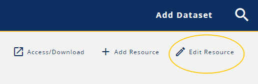
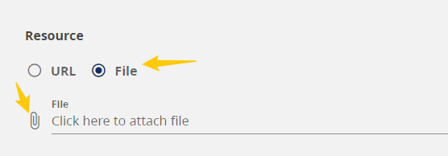
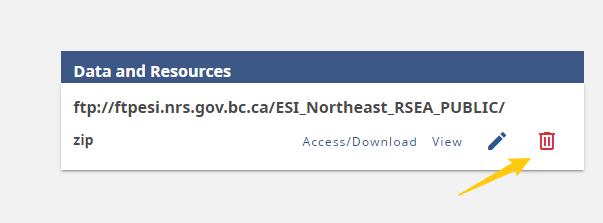
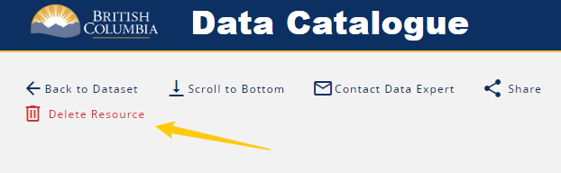

# **BC Data Catalogue Resources**

||**Audience** | |
|:---:|:---:|:---:|
| [*Catalogue Editors*](../glossary.html#metadata_editor) | [*Catalogue Admin*](../glossary.html#metadata_admin) | *Catalogue Developers* |

## Core Administrative and Descriptive Metadata Standard
To align with the [**Core Administrative and Descriptive Metadata Standard**](https://www2.gov.bc.ca/gov/content?id=7284582C81DF4FD6AE89898C535851F1), the following table outlines how the core metadata elements in the Standard align with fields used in the B.C. Data Catalogue.

|Metadata Standard and Guidelines|B.C. Data Catalogue|
|:-|:-:|
|*CREATOR* |[*Published by*](dps_bcdc_w_record_mgmt_ui.md#published-by)|
|*DATE CREATED*|[*Lifecycle event -> Created*](dps_bcdc_w_record_mgmt_ui.md#record-lifecycle-history)|
|*DATE MODIFIED*|[*Lifecycle event -> Modified*](dps_bcdc_w_record_mgmt_ui.md#record-lifecycle-history)|
|*DESCRIPTION*|[*Description*](dps_bcdc_w_record_mgmt_ui.md#description), [*Purpose*](dps_bcdc_w_record_mgmt_ui.md#purpose), [*Quality*](dps_bcdc_w_record_mgmt_ui.md#data-quality), [*Lineage*](dps_bcdc_w_record_mgmt_ui.md#data-lineage), [*Resource Description*](#resouce-description), [*Resource Supplemental Information*](#supplemental-information)|
|*FILE FORMAT*|[*Resource Storage Format*](#resource-storage-format)|
|*SECURITY CLASSIFICATION*|[*Security Classification*](dps_bcdc_w_record_mgmt_ui.md#security-classification)|
|*TITLE*|[*Title*](dps_bcdc_w_record_mgmt_ui.md#title) and [*Resource Title*](#name)|
|*UNIQUE IDENTIFIER*|*Each Record and Resource has a unique identifier. There are obtained by using the Share button*|
|*INFORMATION SCHEDULE*|*This is managed at different levels for organizations, request an engagement with us to determine where it best fits.* |

## Table of Contents

+ [**Resource types**](#resource-types)
   + [Application](#application)
   + [Document/Tabular Data](#document-and-tabular-data)
   + [Geographic Data](#geographic-data)
   + [Web Service and API](#webservice-and-api)
+ [**Resource management**](#resource-management)
   + [Add a Resource](#add-a-resource)
   + [Edit a Resource](#edit-a-resource)
      + [Replace a File in the Catalogue Data Store](#replace-a-file-in-the-catalogue-data-store)
   + [Delete a Resource](#delete-a-resource)
+ [**Resource fields**](#resource-fields)
   + [_Name_](#name) 
   + [_Resource_](#url)
   + [_Type_](#type)
   + [_Resource description_](#resouce-description)
   + [_Supplemental information_](#supplemental-information)
   + [_Frequency of resource update_](#frequency-of-resource-update)
   + [_Resource data last updated_](#resource-data-last-updated)
   + [_Data collection period_](#data-collection-period)
   + [_Resource storage format_](#resource-storage-format)
   + [_Resource storage location_](#resource-storage-location)
   + [_Spatial datatype_](#spatial-datatype)
   + [_Object name_](#object-name)
       + [_Object short name_](#object-short-name)
       + [_Object table comments_](#object-table-comments)
       + [_Details_](#details)
   + [_Projection name_](#projection-name)
   + [_JSON Table Schema_](#json-table-schema)
   + [_ISO Topic Category_](#iso-topic-category)
   + [_Resource type_](#resource-type)
   + [_Resource access method_](#resource-access-method)
   + [_Preview information_](#preview-information)
   + [_Geographic extent_](#geographic-extent)
+ [**DataBC Services - Resource naming and describing guidelines - DRAFT**](#databc-services-resource-naming-and-describing-guidelines---draft)
   + [**BC Geographic Warehouse**](#bc-geographic-warehouse)
      + [Exportable or Not Resources](#exportable-or-not-resources)
         - Exportable; Exportable not enabled
      + [Retired or Replaced Resources](#retired-or-replaced-resources)
         - Export disabled: retired or replaced
      + [Generalized Resources](#generalized-resources)
      + [Web Mapping Resources](#web-mapping-resources)
         - WMS; WFS; Network Link KML; iMapBC or other IMF2 
   + [**ArcGIS Online (AGO)**](#arcgis-online-ago-resources)
       - Data; Web maps; Web apps; Tile services
   + [**BC Data Catalogue Hosted Resources**](#bc-data-catalogue-hosted-resources)
+ [**Additional resources**](#additional-resources)

## Resource types

There are four types of Resources in the BC Data Catalogue.  

### Application

A type of resource associated to a record, which is used for applications that provide access to data.

### Document and Tabular Data

A type of resource associated to a record, which is used for tables in Comma Separated Value (CSV) files, or MS Excel Spreadsheets (XLS) or possibly even tabular PDF files.

### Web Service and API

A resource type associated to a record, which is used for metadata relating to web services or application programming interfaces (APIs).

### Geographic Data

A resource type associated to a record, which is used for data that may, or may not, contains geospatial information along with other data.  Additional geospatial metadata elements are available to be populated, e.g., spatial reference system. This resource type **must** be used for all BCGW resources.

### Notes:
1. Resources may reside, depending on type and size within the Catalogue database itself (Data Store) or be externally referenced.
2. Resources which are sourced from the BC Geographic Warehouse (BCGW) are managed differently.
3. Resources may be only metadata about a resource that is not accessible or requires authorization to access.
    + If a resource requires authorization, we recommend that that process or form is linked as a resource to the record, e.g. [Request Archaeology Information](https://catalogue.data.gov.bc.ca/dataset/a6d58d20-8e19-46ba-b5a0-f02e436fa765/resource/cbbd35ea-8ddb-4cb4-b717-d897e5303dc3).

[RETURN TO TOP][1]

## Resource management

### Add a Resource

**To add a resource:**
1. Click the **Add Resource** button on the toolbar at the record level.
1. Fill out all the required fields for each resource type as described below as noted in the [field section](./dps_bcdc_w_resource_mgmt_ui.md#resource-type-specific-fields).

+ Only files less than 150MB in size can be uploaded to the Catalogue file store.

[RETURN TO TOP][1]

### Edit a Resource

**To edit a resource:**
1. Log In
1. Navigate to the record to edit (that you have the privileges to do so) and either:
    1. Click the **Pencil** icon on the Resource Card list on the right or
       - This will open the resource in edit mode.
       
       
    1. Click on the resource title or the View button. And click on the _Edit Resource_ button.
            
1. Update the file(s) as needed. See the [field section](./dps_bcdc_w_resource_mgmt_ui.md#resource-type-specific-fields) for more details.

[RETURN TO TOP][1]

#### Replace a file in the catalogue Data Store

+ Requirement:
    - Zipped folders can be uploaded but do not upload a file from within an already zipped folder.

1. Once in edit mode of the resource

1. Click on the **File** circle and then the **paper clip** icon 

1. Navigate to new replacement file
1. Click **Open**
1. Click **Save**

[RETURN TO TOP][1]

### Delete a Resource

Editors can delete resources in any published state

**To delete a resource:**
1. Log In
1. Navigate to the record to edit (that you have the privileges to do so) and either:
    1. Click the **trashcan** icon on the Resource Card list on the right and confirm, or
       
    1. Click on the resource title or the View button.
        1. Click on the _Delete Resource_ button and confirm.
        

[RETURN TO TOP][1]

------------

## Resource fields

\* indicates required fields.

### Name \* (`name`) 

+ The name or title of the resource as it will appear on the resource record and card.
+ A well defined name reflects what the resource is about and what the user should expect by accessing the resource.
+ An example BC Data Catalogue record has been published to provide naming standards for common data resources available from the Government of BC
  + Viewable by government staff only when logged in: [BC Data Catalogue Resource Naming Standards](https://catalogue.data.gov.bc.ca/dataset/fe4d0e4b-3294-4c21-b1d9-f46ebe1433c9)

### Resource (`url`) 
+ A link to an externally-referenced resource (URL) or a file uploaded for storage within the Catalogue database itself (Data Store).

### Type \* (`bcdc_type`) 
+ The type of resource associated with to a record. All BCGW records should be set to Geographic Data.
+ Types:
  + Document/Tabular (`dataset`)
  + Geographic Data (`geographic`)
  + Web Service/API (`webservice`)
  + Application (`application`)

### Resource description (`description`)  
+ Detailed information about the resource.
+ Core Administrative and Descriptive Metadata Standard: This field aligns with the element **DESCRIPTION**.

### Supplemental information (`supplemental_info`) 
+ Other descriptive or additional relevant information about the resource.

### Frequency of resource update \* (`resource_update_cycle`) 
+ Describes how often the resource is intended to be updated or reloaded.

### Resource data last updated \* (`last_modified`)  
+ Provides the date when the resource was last updated.
+ NOTE: automated field and only visible in view mode for datasets:
    + Uploaded to the catalogue  itself (Data Store)
    + Published to the BC Geographic Warehouse
        + An automated system pushes the reloaded timestamp
+ Core Administrative and Descriptive Metadata Standard: This field aligns with the element **DATE MODIFIED**

### Data collection period (`temporal_extent`)  
+ A Start and/or End Data can be added if the data reflects a period of time.'.
+ Beginning date (`beginning_date`)
    - The start date for the period the data is captured for
+ End date (`end_date`): 
    - The end date for the period the data is captured for.

### Resource storage format \* (`format`) 
+ Describes the file type or format in which the resource is provided.
+ Core Administrative and Descriptive Metadata Standard: This field aligns with the element **FORMAT**

### Resource storage location \* (`resource_storage_location`) 
+ The location where the resource is stored

### Spatial datatype \* (`spatial_datatype`) 
+ The geometry data type in a database e.g., BCGW Oracle Database = SDO_GEOMETRY.

### Object name (`object_name`) 
+ Is the name of the dataset stored in a database e.g., BCGW Oracle Database = SDO_GEOMETRY.

### **Object short name** (`object_short_name`) 
+ For BCGW datasets, the short name used for download of shapefiles.
+ NOTE: automated field and only visible in view mode for datasets where the **Resource Storage Location** is 'BC Geographic Warehouse'

### **Object table comments** (`object_table_comments`)  
+ For BCGW datasets, the dataset's comment or description in a database
+ NOTE: automated field and only visible in view mode for datasets where the **Resource Storage Location** is 'BC Geographic Warehouse'

### **Details**: (`details`) **Section** 
+ The data dictionary of a dataset in a database.
+ NOTE: automated field and only visible in view mode for datasets where the **Resource Storage Location** is 'BC Geographic Warehouse'
   + **Column name** (`column_name`): The name of the column in a database
   + **Short name** (`short_name`): The short name of columns, used for downloading as shapefiles and CSV
   + **Data type** (`data_type`): The column type in a database (e.g., number, text)
   + **Data precision** (`data_precision`): The column length in a database
   + **Column comments** (`column_comments`): The column's comment or description in a database

### Spatial reference system \* (`projection_name`) 
+ The projection the spatial or geographic dataset which it is stored in.
+ This is a drop down list of common projections used in BC for geographic data.

### JSON Table Schema (`json_table_schema`) 
+ Optional: JSON-based specification for describing the structure, field types, and validation rules of tabular data

### ISO Topic Category \* (`iso_topic_category`) 
+ [ISO 19115-1:2014](https://www.iso.org/standard/53798.html)
+ Choose at least one topic from a drop-down list

### **Resource type** (`resource_type`) 
+ The classification of the data or resource
 + Abstraction (conceptual representation)
 + Data (dataset)
 + Reports (documentation)

### Resource access method \* (`resource_access_method`)  
+ Describes how the end-user can access the data (Application, Direct, Indirect, Service, Other)
+ For BCGW data that is downloadable, then Indirect access is a reasonable choice.

### Preview information (`preview_info`) **Section**  
+ NOTE: Automatically populated if public data in the BCGW in order to build the Map Preview.
+ Used for previewing a Web Mapping Service image within a mapping application
  + **Layer name** (`layer_name`): is the name of the BCGW object and is only different if the WMS uses a generalized version of the dataset.
  + **Preview latitude** (`preview_latitude`): allows you to provide a map preview centroid latitude.
  + **Preview longitude** (`preview_longitude`): allows you to provide a map preview centroid longitude.
  + **Preview map aervice URL** (`preview_map_service_url`): allows you to provide an alias for the map service URL.
  + **Preview zoom level** (`preview_zoom_level`): allows you to provide an initial zoom level for the map preview.
  + **Image URL** (`preview_image_url`): shows a preview of the data as a static image.
  + **Link to iMapBC** (`link_to_imap`): shows an interactive preview of the data in iMapBC and should include at least one presentation layer's Layer-ID.

### Geographic extent (`geographic_extent`) **Section**  
+ NOTE: Automatically populated with the bounding box of the province.
  + **North** (`north_bound_latitude`): 60.0
  + **South** (`south_bound_latitude`): 48.0
  + **East** (`east_bound_longitude`): -113.5
  + **West** (`west_bound_longitude`):-139.5

----------------

Click **Save** when done

+ Additional resources can be added by repeating the process above or adding other resource types.

[RETURN TO TOP][1]

---------------

## DataBC Services naming and describing guidelines - DRAFT

Standardized resource names for DataBC resources have been published as a BC Data Catalogue record (requires log-in): [BC Data Catalogue Resource Naming Standards](https://catalogue.data.gov.bc.ca/dataset/fe4d0e4b-3294-4c21-b1d9-f46ebe1433c9)

This section is currently being developed.

### BC Geographic Warehouse

+ BC Geographic Warehouse is a selection available in the Resource Storage Location.  
+ Certain resources will be generated on your behalf, including:
    - Downloadable or not
         - This is created when working with the Data Publication Services team.
    - WMS
         - This is generated the week after publication to iMapBC.
         - However, the script to automate the creation of these catalogue references is being redeveloped. 
         - See [Getting started](..#dps_bcdc_w_start.md) for links to our request system
    - Network Link KML
         - This is generated the week after publication to iMapBC.
         - However, the script to automate the creation of these catalogue references is being redeveloped. 
+ Certain resources are in review for automatic generation, including:
    - ArcGIS Online if hosted or served out through DataBC
    - WFS
    - iMapBC 
+ Certain fields will be populated on your behalf, including:
    - Preview Details - includes map visible in the Preview popup and iMapBC link
    - Object Details

#### Downloadable or Not Downloadable Resources

|Catalogue Fields| Exportable|Not Exportable
|:---|:---|:---|
|Title |Data - BC Geographic Warehouse (custom download)|Data - BC Geographic Warehouse (not downloadable)|
|URL| Leave blank |Leave blank
|Resource type|Geographic|Geographic|
|Resource description|The Distribution Service allows for data to be exportable in various file formats from the B.C. Geographic Warehouse (BCGW), a central government repository of spatial and non-spatial data.|The Distribution Service has not been enabled for export this data from the B.C. Geographic Warehouse (BCGW), a central government repository of spatial and non-spatial data.
|Supplemenental info|See the main dataset page for more information.|The Distribution Service has been disabled for the data from the B.C. Geographic Warehouse (BCGW), a central government repository of spatial and non-spatial data.
|Supplemenental info|Where data is made available for download, the user can customize the coordinate system, select from a tabular or multiple geospatial formats, and apply an area of interest to the output file.|This dataset is not available for download.|
|Resource storage format|multiple|Oracle/SDE|
|Resource storage location|BC Geographic Warehouse|BC Geographic Warehouse|
|Spatial datatype|SDO Geometry|SDO Geometry|
|Object name|SCHEMA.TABLE|SCHEMA.TABLE|
|Projection name|EPSG_3005 - NAD83 BC Albers|EPSG_3005 - NAD83 BC Albers|
|Resource access method|Indirect|Indirect|

**Specific Field Requirements to Enable Export**
+ To enable the **Download/Access** button to pop-up the Persistent Order Widget (POW) the following must be populated:
    1. **Name:** Must contain "Custom Download" 
        + Suggestions are in the above table for best titles if downloadable or not
    3. **Resource Storage Location:** "BC Geographic Warehouse"
    4. **Object name:** e.g., _"WHSE_ADMIN_BOUNDARIES.ADM_NR_DISTRICTS_SP"_

+ **Object name**
    - Is the name of the dataset stored in a database.
    - Enter the _SCHEMA.OBJECT_ , e.g., WHSE_ADMIN_BOUNDARIES.ADM_NR_DISTRICTS_SP
    - The object name is what is used to automatically populate the metadata record with
        - The data definitions table that is extracted from the Oracle metadata.
        - For public datasets that are available in iMapBC:
            - The _WMS getCapabilities request_ resources
            - The _Network Link KML_ resources
            - The _Preview Map_ details
            - The _View in iMapBC_ button will that dataset's specific presentations
     - Always check to make sure there is no space at the end of the value.

#### Retired or Replaced Resources

|Catalogue Fields| Retired|Replaced|
|:---|:---|:---|
|Title |Retired BC Geographic Warehouse (not downloadable)|Replaced BC Geographic Warehouse (not downloadable)|
|URL| Leave blank |Leave blank|
|Type|Geographic|Geographic
|Resource Description|
|Supplemenental Info|See the main dataset page for more information.|See the main dataset page for more information.|
|Resource Storage Format|multiple|Oracle/SDE|
|Resource Storage Location|BC Geographic Warehouse|BC Geographic Warehouse|
|Spatial Datatype|SDO Geometry|SDO Geometry|
|Object Name|SCHEMA.TABLE|SCHEMA.TABLE|
|Projection|EPSG_3005 - NAD83 BC Albers|EPSG_3005 - NAD83 BC Albers|
|Resource Access Method|Indirect|Indirect|

#### Generalized Resources

Generalized resources are now to be included as an additional resource on the non-generalized record.

|Catalogue Fields| Text Examples|
|:---|:---|
|Title |Data - BC Geographic Warehouse (not downloadable)|
|Resource description|The Distribution Service has not been enabled to allow for data to be downloaded in various file formats from the B.C. Geographic Warehouse (BCGW), a central government repository of spatial and non-spatial data. See the main page for additional information.|
|Resource storage format| Oracle/SDE |

#### Web Mapping Resources

|Catalogue Fields| WMS|WFS|Network Link KML |iMapBC|
|:---|:---|:---|:---|:---|
|Title |WMS - Web Map Service|WFS - Web Feature Service|KML - Keyhole Markup Language|iMapBC Layer|
|URL| Leave blank for all of these
|Type|Web Service/API|
|Resource description|Web Mapping Service (WMS) allows for data to be fed out via a service from the B.C. Geographic Warehouse (BCGW), a central government repository of spatial and non-spatial data.|
|Supplemenental info|Click <b>Access/Download</b> in the toolbar to see or copy the WMS call. For more information see [Web Mapping Services](https://www2.gov.bc.ca/gov/content?id=95D78D544B244F34B89223EF069DF74E).|
|Resource storage format|wms|wfs|kml|html or geojson
|Resource storage location|BC Geographic Warehouse|
|Spatial datatype|SDO Geometry|
|Object name|SCHEMA.TABLE
|Projection name|ESPG_4326 - WSG84 World Geodedic System 1984|ESPG_4326 - WSG84 World Geodedic System 1984|ESPG_4326 - WSG84 World Geodedic System 1984|
|Resource access method|Service|Service|Service|Application|

### ArcGIS Online (AGO) Resources

|Catalogue Fields| Data|Web Maps|Web Apps|Tile Services|
|:---|:---|:---|:---|:---|
|Title |ArcGIS Online - Feature Layer|ArcGIS Online - Web map|ArcGIS Online - Web app|ArcGIS Online - Tile Layer|
|URL| Leave blank for all of these
|Type|Geographic|Application|Application|Service|
|Resource description|The Distribution Service allows for data to be downloaded in various file formats from the B.C. Geographic Warehouse (BCGW), a central government repository of spatial and non-spatial data.|
|Supplemenental info|Click <b>Access/Download</b> in the toolbar to download this dataset. For more information on using the distribution order form see [How to download data using the Catalogue or iMapBC](https://bcgov.github.io/data-publication/pages/dps_data_distribution_w.html).|
|Resource storage format|ArcGIS Rest|other|other|other
|Resource storage location|BC Geographic Warehouse or ESRI ARcGIS Online if hosted|
|Spatial datatype|SDO Geometry|
|Object name|SCHEMA.TABLE
|Projection name|EPSG_3005 - NAD83 BC Albers or hosted is ESPG_3857|Not Applicable|Not Applicable|
|Resource access method|Direct|Application|Application|Direct|

## BC Data Catalogue Hosted Resources

[RETURN TO TOP][1]

---------------
## Additional resources
+ See the full list of value options for drop down fields, see the [BCDC Schema](https://catalogue.data.gov.bc.ca/api/3/action/scheming_dataset_schema_show?type=bcdc_dataset)
+ See all documented changes in the [Change Log](https://github.com/bcgov/ckan-ui/blob/master/pages/beta_schema_changes.md#field-label-and-value-changes)

---------------

[RETURN TO TOP][1]

[1]: #bc-data-catalogue-resources

